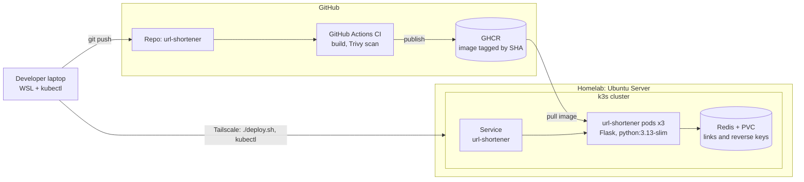

# URL Shortener on Kubernetes

A Python URL shortener that I containerized with Docker and run on a local Kubernetes cluster as 3 self-healing, load-balanced pods backed by a password-protected, persistent Redis database.

## Features

- Shortens long links into short codes and redirects visitors to the original URL; unknown codes return a 404
- Runs as 3 load-balanced replicas that Kubernetes replaces automatically if one crashes
- Reads its settings from a ConfigMap and its Redis password from a Kubernetes Secret, so no passwords live in the code or the image
- Keeps every link through Redis restarts using a persistent volume and append-only mode
- Health checks: readiness stops traffic to pods that can't reach Redis, and liveness restarts only a truly stuck app
- One-command start, stop, and versioned deploys with shell scripts
- /links - lists every short link with a count. Duplicate detection of shortened links within /shorten

## Tech Stack

- **Python:3.13-slim + Flask:** the web app
- **Redis:** stores short codes and their URLs
- **Docker:** packages the app into images
- **Kubernetes (kind):** runs and manages the containers on a local cluster
- **Bash:** automation scripts for start, stop, and deploy
- **K3s** kubernetes running on home server
- **Tailscale** remote access into home server
- **GHCR** github container registry
- **Trivy** security scanner


## Architecture



- The **Service** load-balances requests across 3 identical, stateless app pods.
- App pods find Redis by its Service name (`redis`) through Kubernetes DNS.
- Redis requires a password stored in a **Secret**, and saves data to a **PersistentVolumeClaim**, so a new Redis pod reloads every link.

## CI/CD

Every push to `main` builds, scans, and publishes a new image. Deploying it is one command.

```
git push → GitHub Actions: build → Trivy scan → publish to GHCR → ./deploy.sh → k3s rolls out
```

### CI (`.github/workflows/ci.yml`), automatic on every push
1. **Build** the Docker image, tagged with the commit SHA
2. **Scan** it with Trivy. The build **fails** on any fixable HIGH or CRITICAL vulnerability, so a vulnerable image is never published
3. **Publish** to GitHub Container Registry: `ghcr.io/jxcarter92/url-shortener:<SHA>`

The workflow uses least-privilege permissions (`contents: read`, `packages: write`) and GitHub's built-in token, with no stored passwords.

### CD (`deploy.sh`), one command
After CI passes:
```bash
./deploy.sh
```
1. Gets the current commit SHA
2. Updates the image tag in `deployment.yaml` with `sed`
3. `kubectl apply`, then waits for the zero-downtime rolling update
4. Commits and pushes the updated `deployment.yaml` with `[skip ci]`, so Git always matches what's running

### Next: GitOps with Argo CD
Argo CD will watch this repo and apply changes automatically, so a `git push` alone deploys.

## Project structure

```
url-shortener/
├── .github/workflows/ci.yml   # CI: build image, Trivy scan, publish to GHCR
├── app.py                     # Flask app: /shorten, /<code>, /links, /healthz
├── Dockerfile                 # python:3.13-slim, pip removed, runs as non-root user
├── requirements.txt           # flask, redis
├── deployment.yaml            # url-shortener Deployment (3 replicas, probes, GHCR image)
├── service.yaml               # Service: port 80 → container port 5000
├── redis.yaml                 # Redis Deployment + Service (password from Secret)
├── configmap.yaml             # REDIS_HOST setting
├── pvc.yaml                   # 1Gi volume so Redis data survives restarts
├── deploy.sh                  # Deploy the current commit: update SHA, apply, rollout, commit
├── test.sh                    # Local test: build and run against a throwaway Redis
├── port.sh                    # Port-forward the Service to localhost:8080
├── start.sh                   # (kind only) start the local kind cluster
└── stop.sh                    # (kind only) stop the local kind cluster
```

The Redis password is a Kubernetes Secret created by command, so it's never stored in this repo.

## Getting started

### Prerequisites
- Docker
- A Kubernetes cluster (I use **k3s** on a homelab server; **kind** works for local practice)
- `kubectl` pointed at that cluster

### Option 1: Test locally with Docker (no Kubernetes)

One-time setup: a private Docker network and a throwaway Redis:
```bash
docker network create testnet
docker run -d --name redis-test --network testnet redis:7
```

Then build and run the app against it:
```bash
./test.sh
```

In another terminal:
```bash
curl -X POST -d "url=https://example.com" localhost:5000/shorten
curl localhost:5000/links
```

Clean up when finished:
```bash
docker rm -f redis-test
docker network rm testnet
```

### Option 2: Deploy to Kubernetes

1. **Create the Redis password Secret.** The password is read silently, so it never lands in shell history:
   ```bash
   read -s REDIS_PW
   kubectl create secret generic redis-secret --from-literal="REDIS_PASSWORD=$REDIS_PW"
   ```
2. **Deploy everything:**
   ```bash
   kubectl apply -f .
   kubectl get pods -w
   ```
3. **Reach the app:**
   ```bash
   ./port.sh
   ```
   Then open `http://localhost:8080`.

After the first deploy, release new versions with `./deploy.sh` (see [CI/CD](#cicd)).

## Usage

With the Service port-forwarded (`./port.sh` or `kubectl port-forward service/url-shortener 8080:80`):

**Shorten a URL**
```bash
curl -X POST -d "url=https://github.com/jxcarter92" localhost:8080/shorten
# EK0ZaQ
```

**Shorten the same URL again (duplicate detection)**
```bash
curl -X POST -d "url=https://github.com/jxcarter92" localhost:8080/shorten
# Link already in use. Use code: EK0ZaQ
```
The same URL always returns the same code, using a reverse-lookup key in Redis (`url:<long URL> → code`).

**Follow a short link**
```bash
curl -i localhost:8080/EK0ZaQ
# HTTP/1.1 302 FOUND
# Location: https://github.com/jxcarter92
```

**List all stored links**
```bash
curl localhost:8080/links
# {"links": {"EK0ZaQ": "https://github.com/jxcarter92"}, "links_stored": 1, "message": "successfully retrieved 1 links"}
```

**Health check**
```bash
curl localhost:8080/healthz
# {"pod": "url-shortener-...", "redis": "connected", "status": "ok"}
```

## Resilience Tests

| Test | Command | Result |
| --- | --- | --- |
| Self-healing | `kubectl delete pod <app pod>` | Replacement pod starts immediately |
| Data survives Redis restart | `kubectl delete pod <redis pod>` | Existing links still redirect (302) |
| Redis outage | `kubectl scale deployment redis --replicas=0` | App pods go not-ready (0/1) with no restarts; traffic stops |
| Recovery | `kubectl scale deployment redis --replicas=1` | Pods return to ready on their own; no data lost |
| Auth required | `redis-cli -h redis ping` without a password | `NOAUTH Authentication required.` |

## What I learned

**Debugging a real outage.** After moving to the homelab, pods failed with `ErrImagePull` and `lookup ghcr.io: Try again`. I ruled out the image tag, Tailscale, and router speed one at a time, then found the cause with `dig`: my router never answered IPv6 (AAAA) DNS lookups, so image pulls timed out. I pointed the server at public DNS with netplan, using `netplan try` as a safety net, and the pulls worked.

**Security gates catch real problems.** Trivy failed the build twice: first on vulnerable libraries bundled inside pip (fixed by removing pip from the image), then on HIGH CVEs in OS packages from the Debian base image. Instead of patching every time, I switched to `python:3.13-slim`, which removes most of those packages and shrinks the attack surface.

**Stateless vs. stateful.** The app pods hold no data, so they can be replaced at any time. Every link lives in Redis on a PersistentVolume. I deleted and replaced pods many times, and no links were lost.

**Test locally first.** `test.sh` runs the real container image against a throwaway Redis on a Docker network, so I catch bugs in seconds instead of waiting on CI, and broken code never reaches production.

**Automate what you understand.** I deployed by hand first (push, find the SHA, edit the YAML, apply, watch the rollout), then turned those steps into `deploy.sh`. Next, Argo CD automates the rest.

## Next steps

- [ ] **Argo CD:** GitOps, so `git push` alone deploys
- [ ] **CI path filters:** skip builds when only `deployment.yaml` changes
- [ ] **deploy.sh safety check:** confirm the image exists in GHCR before deploying
- [ ] **Ingress (Traefik):** reach the app by URL instead of port-forward
- [ ] **Monitoring:** Prometheus and Grafana
- [ ] **Production server:** replace Flask's development server with gunicorn