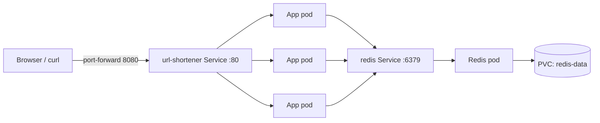

# URL Shortener on Kubernetes

A Python URL shortener that I containerized with Docker and run on a local Kubernetes cluster as 3 self-healing, load-balanced pods backed by a password-protected, persistent Redis database.

## Features

- Shortens long links into short codes and redirects visitors to the original URL; unknown codes return a 404
- Runs as 3 load-balanced replicas that Kubernetes replaces automatically if one crashes
- Reads its settings from a ConfigMap and its Redis password from a Kubernetes Secret, so no passwords live in the code or the image
- Keeps every link through Redis restarts using a persistent volume and append-only mode
- Health checks: readiness stops traffic to pods that can't reach Redis, and liveness restarts only a truly stuck app
- One-command start, stop, and versioned deploys with shell scripts

## Tech Stack

- **Python + Flask:** the web app
- **Redis:** stores short codes and their URLs
- **Docker:** packages the app into images
- **Kubernetes (kind):** runs and manages the containers on a local cluster
- **Bash:** automation scripts for start, stop, and deploy

## Architecture



- The **Service** load-balances requests across 3 identical, stateless app pods.
- App pods find Redis by its Service name (`redis`) through Kubernetes DNS.
- Redis requires a password stored in a **Secret**, and saves data to a **PersistentVolumeClaim**, so a new Redis pod reloads every link.

## Project Structure

```text
app.py            Flask app: /, /shorten, /<code>, /healthz
Dockerfile        Builds the app image (runs as a non-root user)
requirements.txt  Python dependencies
deployment.yaml   App Deployment: 3 replicas, config, secret, probes
service.yaml      Stable address for the app pods
redis.yaml        Redis Deployment (password, persistence) + Service
configmap.yaml    App settings (REDIS_HOST)
pvc.yaml          1Gi persistent disk for Redis
start.sh          Starts the cluster and waits until everything is ready
stop.sh           Stops the cluster
deploy.sh         Builds, loads, and rolls out a new version
port.sh           Opens a tunnel to the app at location kubectl port-forward service/url-shortener                    8080:80
```

## Getting Started

### Prerequisites

- Windows with WSL 2 (Ubuntu)
- Docker Desktop with WSL integration enabled for Ubuntu
- kubectl
- kind

### First-time setup

```bash
kind create cluster
kubectl create secret generic redis-secret --from-literal='REDIS_PASSWORD=<your-password>'
kubectl apply -f .
./deploy.sh v1
```

### Everyday use

```bash
./start.sh            # start the cluster and wait until ready
./deploy.sh v2        # ship a new version (use a new tag each time)
./stop.sh             # stop the cluster
./port.sh             # runs kubectl port-forward service/url-shortener 8080:80
```

## Usage

```bash
# Terminal 1: open a tunnel to the app
kubectl port-forward service/url-shortener 8080:80

# Terminal 2: shorten a link
curl -d "url=https://github.com" localhost:8080/shorten
# -> mXpVbQ

# Follow it
curl -i localhost:8080/mXpVbQ       # 302 FOUND, Location: https://github.com

# Health check
curl localhost:8080/healthz
# {"pod":"url-shortener-...","redis":"connected","status":"ok"}
```

## Resilience Tests

| Test | Command | Result |
| --- | --- | --- |
| Self-healing | `kubectl delete pod <app pod>` | Replacement pod starts immediately |
| Data survives Redis restart | `kubectl delete pod <redis pod>` | Existing links still redirect (302) |
| Redis outage | `kubectl scale deployment redis --replicas=0` | App pods go not-ready (0/1) with no restarts; traffic stops |
| Recovery | `kubectl scale deployment redis --replicas=1` | Pods return to ready on their own; no data lost |
| Auth required | `redis-cli -h redis ping` without a password | `NOAUTH Authentication required.` |

## What I Learned

- **Reading logs and tracebacks:** a 500 error turned out to be `r.get(code, long_url)`; I found it with `kubectl logs -l app=url-shortener`, fixed it, and rolled out a new version.
- **Stateless vs. stateful:** deleting the Redis pod first wiped every link, because data lived in memory. Adding a PVC and append-only mode fixed it.
- **Config and secrets:** settings moved to a ConfigMap and the password to a Secret. Secrets are base64-encoded, not encrypted, so they never go in Git.
- **Probes:** liveness should check only the app; readiness checks dependencies. Otherwise a Redis outage would restart every app pod for nothing.
- **Rolling updates:** a release that couldn't pull its image stalled safely while the old pods kept serving.
- **Automation:** wrapping the build, load, and deploy commands in scripts made releases one command.
- **Kubernetes and Containers** playing with containers and pods and seeing how I can utilize the power these tools offer. 

## Next Steps

- GitHub Actions pipeline: build the image, scan it with Trivy, and publish it
- Pin the base image to an exact version for reproducible builds
- Run on an always-on cluster with GitOps (Argo CD)
